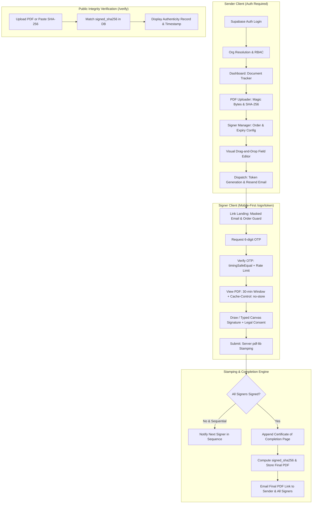

# AuthSign Technical Architecture & Extension Guide

## 1. System Topology & Design Principles

AuthSign is a secure, multi-tenant enterprise electronic signature application built on Next.js 15 (App Router), Supabase (PostgreSQL, Auth, and Private Storage), and `pdf-lib`.



---

## 2. Multi-Tenancy & Row-Level Security (RLS)

All tables are strictly scoped by organization membership:
1. `is_member(org_id)` security-definer helper checks if `auth.uid()` belongs to `members` for that organization.
2. `doc_org_ok(doc_id)` security-definer helper verifies that the current authenticated user's organization owns the document.
3. Roles supported:
   - `owner`: full organization and document management
   - `admin`: member invitation and document management
   - `sender`: document upload, field placement, and dispatch
   - `viewer`: read-only access to organization documents
4. **Zero Anon DB Access for Signers**: There are **no anonymous RLS policies** exposing signer tables or OTP challenges to client browsers. Signers interact exclusively through server endpoints executed via the Supabase Service Role key.
5. **Locked OTP Challenges**: `otp_challenges` has RLS enabled with zero policies. Only server-side queries using the service role key can query or insert into this table.

---

## 3. Cryptographic Security Standards

1. **Signer Link Tokens**:
   - High-entropy 32 random bytes (`base64url`).
   - The raw token is **never stored** in the database; only its `SHA-256(token)` hex digest is persisted.
2. **OTP Security**:
   - 6-digit random integers generated via `crypto.randomInt(100000, 1000000)`.
   - Hashed using `SHA-256(signerId:code:OTP_PEPPER)`.
   - Verified in constant time via `crypto.timingSafeEqual` to prevent timing side channels.
   - Lifetime: 10 minutes.
   - Lockout: Maximum 5 failed attempts per challenge.
   - Rate limiting: Maximum 3 OTP send requests per signer per 10 minutes.
3. **Session Windows**:
   - Successful OTP records `signers.verified_at = now()`.
   - Viewing the PDF stream (`/api/sign/[token]/pdf`) and submitting signatures (`/api/sign/[token]/submit`) enforce `verified_at` within the last 30 minutes.
4. **Append-Only DB Trigger**:
   - `audit_events` is protected by a PostgreSQL database trigger (`trg_audit_events_immutable`) that raises an exception on any attempted `UPDATE` or `DELETE`.

---

## 4. Pluggable Provider Architecture & Extension Guide

Located in `src/lib/providers/`, the application defines clean provider interfaces so Phase 2 extensions (such as Aadhaar eSign and legal e-stamping) can be dropped in without refactoring core signing controllers.

### Core Contracts (`src/lib/providers/types.ts`)
```typescript
export interface VerificationProvider {
  readonly method: 'email_otp' | 'aadhaar_otp';
  start(params: VerificationStartParams): Promise<VerificationStartResult>;
  verify(params: VerificationVerifyParams): Promise<VerificationVerifyResult>;
}

export interface SignatureProvider {
  readonly method: 'draw' | 'typed' | 'aadhaar_esign' | 'auto_seal';
  initiate(params: SignatureInitiateParams): Promise<SignatureInitiateResult>;
  complete(params: SignatureCompleteParams): Promise<SignatureCompleteResult>;
}

export interface StampProvider {
  createStamp(state: string, amount: number, parties: StampParty[]): Promise<StampResult>;
}
```

### Future Implementation: Aadhaar eSign (`AadhaarEsignProvider`)
To add Aadhaar eSign in Phase 2:
1. Create `src/lib/providers/signature/aadhaar-esign.provider.ts` implementing `SignatureProvider`.
2. In `initiate()`:
   - Compute the document hash.
   - Request an XML signing request from the ESP (Electronic Service Provider, e.g. NSDL or CDSL gateway).
   - Return `{ redirectUrl: espGatewayUrl }`.
3. In `complete()`:
   - Verify the ESP's PKCS#7 / CMS response signature.
   - Extract signer's certificate metadata (Cert Serial, Issuer, Timestamp).
   - Store certificate details in `signatures.cert_info` (JSONB) and ESP transaction ID in `signatures.provider_txn_id`.
   - **Crucial Compliance Rule**: Never store Aadhaar numbers anywhere in the application or logs.
4. Register `AadhaarEsignProvider` in `src/lib/providers/index.ts`. No database changes required!

### Future Implementation: Digital E-Stamping (`NeSLStampProvider`)
To add legal e-stamping:
1. Create `src/lib/providers/stamp/nesl-stamp.provider.ts` implementing `StampProvider`.
2. In `createStamp(state, amount, parties)`:
   - Call NeSL / SHCIL digital stamping API.
   - Obtain digital stamp certificate PDF page and reference number.
   - Prepend stamp certificate page to the document before field stamping.
   - Store stamp reference in `documents.stamp_ref` and amount in `documents.stamp_amount`.
3. Swap `getStampProvider()` in `src/lib/providers/index.ts`.

---

## 5. Persistent Link States & Expiry Behavior

When an invitee or sender clicks a signing link (`/sign/[token]`):
1. **COMPLETED State**:
   - If `documents.status === 'completed'`: Displays a green checkmark icon with *"Document has been signed"*, execution timestamp, and a download button for the certified signed copy. Accessible any time, on any day.
2. **EXPIRED State**:
   - If `now() > documents.expires_at`: Displays an expiration notice: *"This signing link has expired. Time over. Please connect with [Organization Name] to request a new signing link."*
3. **ALREADY SIGNED State**:
   - If signer has `status === 'signed'` but others are pending in sequential mode: Displays *"You have signed this document. Waiting for remaining signatories to finish."*
4. **SEQUENTIAL BLOCKED State**:
   - If `signing_order === 'sequential'` and any prior signer has not signed: Displays *"Awaiting signature from [Signer 1]. You will be notified via email when it is your turn."*
